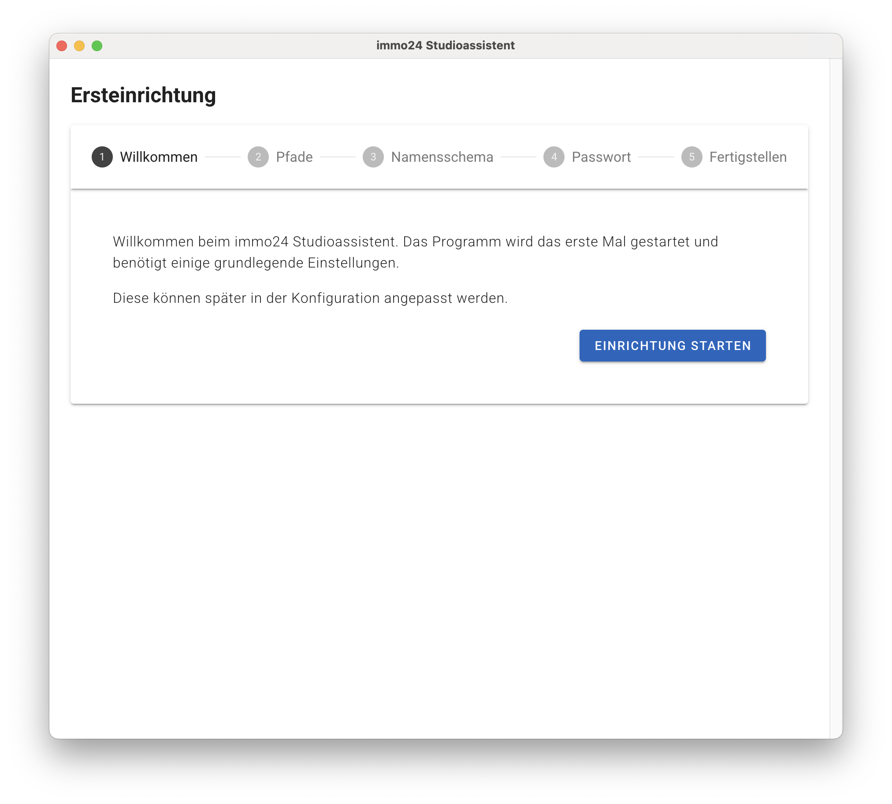
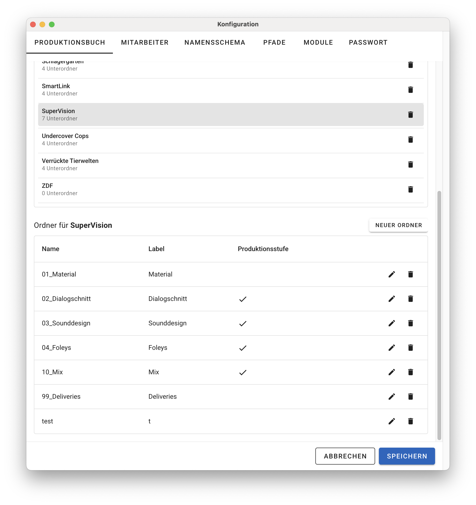
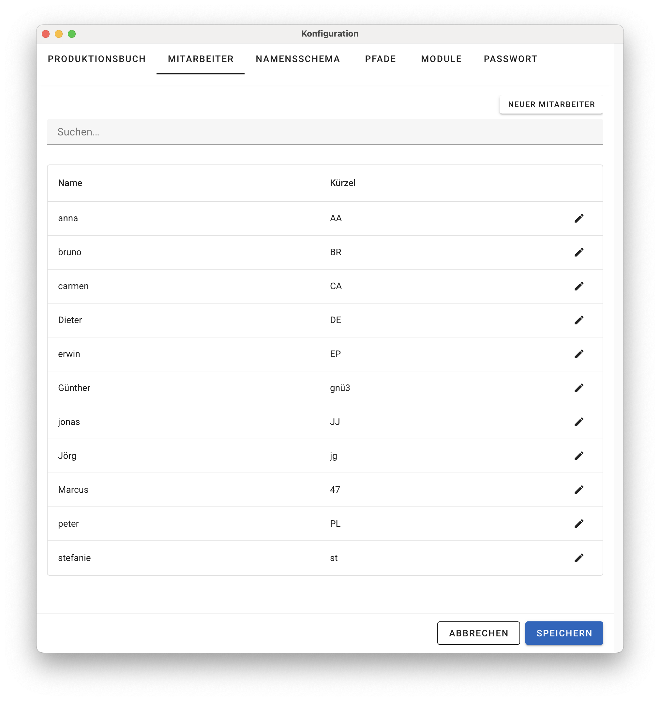
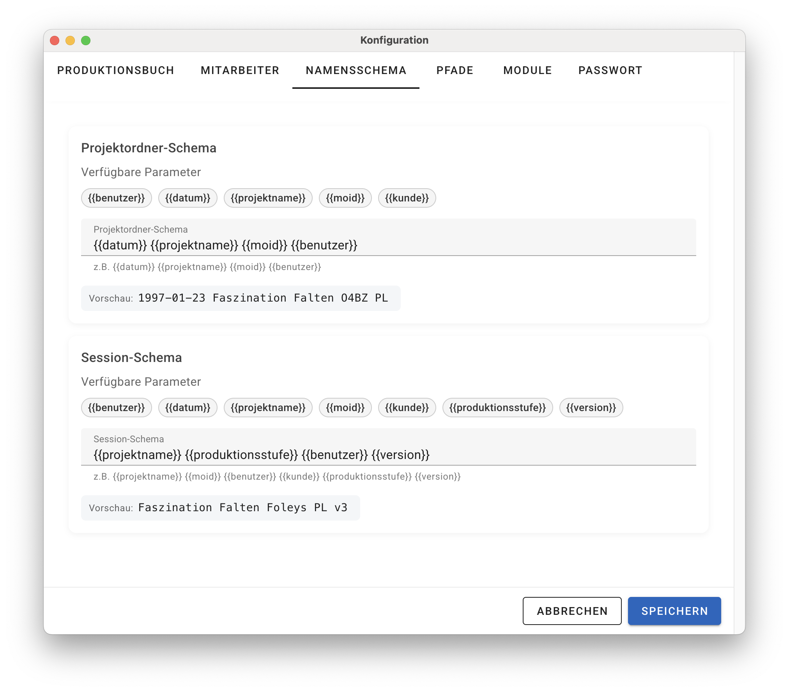
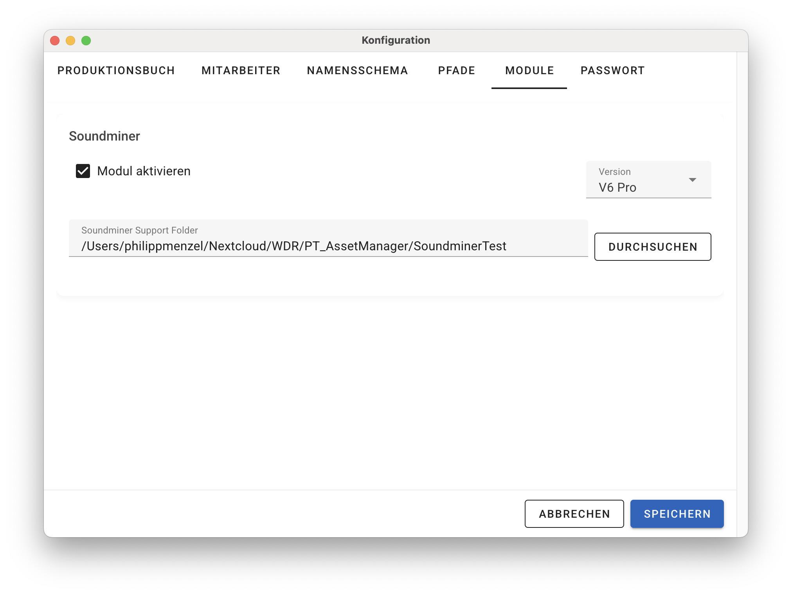
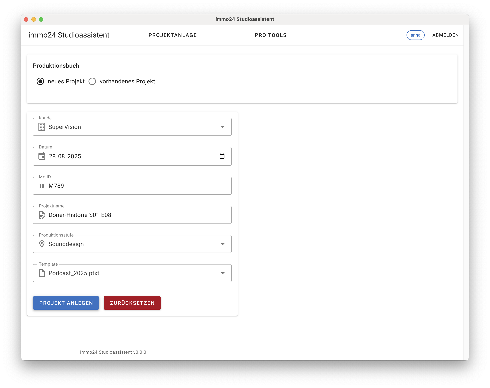
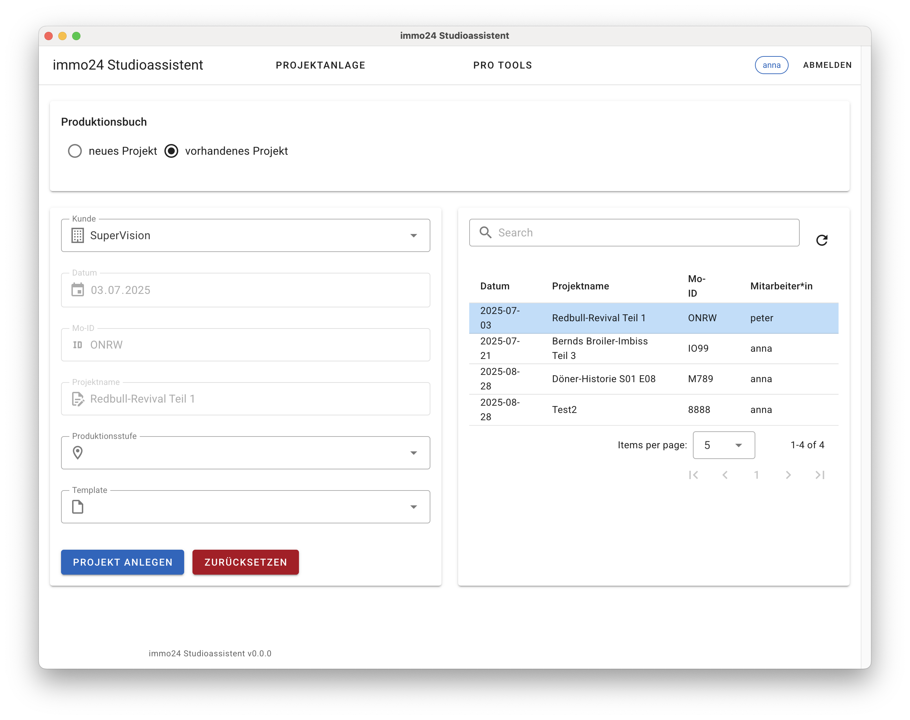
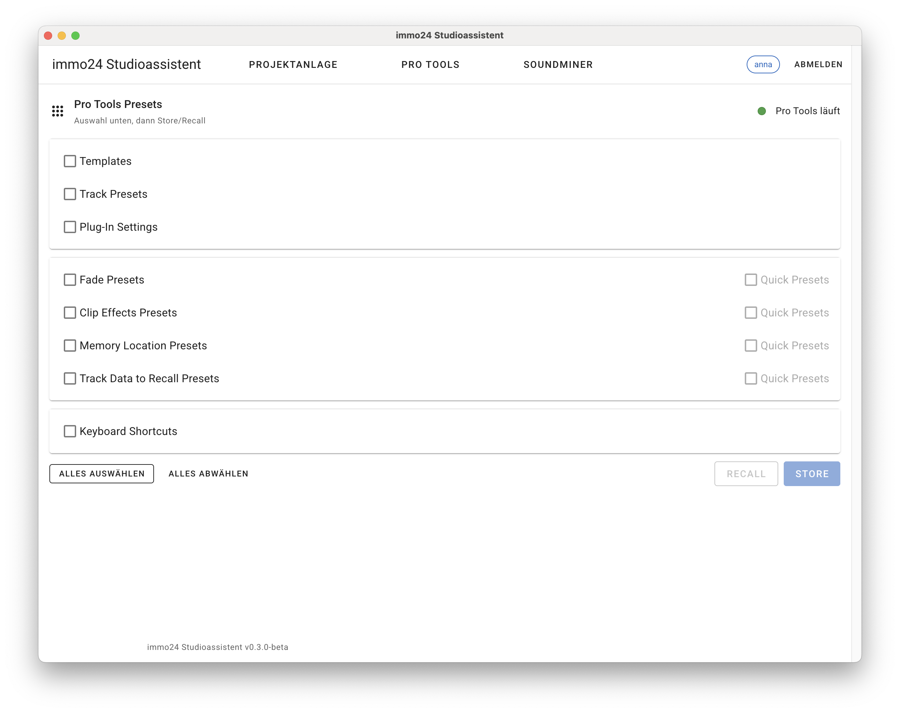
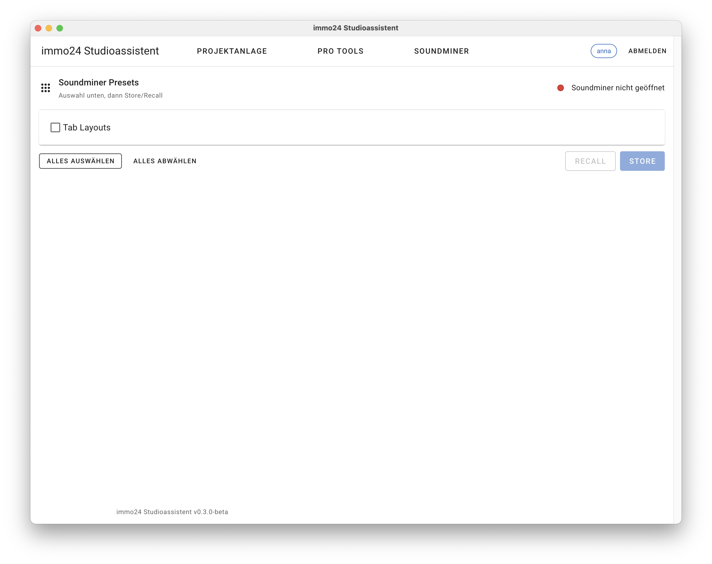

# immo24 Studioassistent

Der **immo24 Studioassistent** ist eine Desktop-Anwendung zur Verwaltung von Projekten und Presets auf vernetzten Avid Pro Tools Systemen.

---

## 🚀 Features

- Projektanlage nach Namenskonventionen und Vorlagen  
- Automatische Verzeichnisstruktur mit Produktionsstufen  
- Speichern und Abrufen von Pro Tools Presets (Store/Recall)
- Speichern und Abrufen von Soundminer Presets (Store/Recall)
- Multi-User Funktionalität mit Benutzer-Login  
- Cross-Plattform (macOS & Windows)  

---

## 🧑‍💻 Ersteinrichtung

Beim ersten Start erscheint der **Einrichtungsassistent**.  
Er führt durch die grundlegenden Einstellungen, die später jederzeit im Konfigurationsmenü angepasst werden können.

---

## ⚙️ Konfiguration

Das Konfigurationsmenü öffnet man über:  
**Menüleiste → immo24 Studioassistent → Konfiguration**  
oder per Tastenkürzel: **CMD+,** (macOS) / **STRG+,** (Windows).  

> Die Konfiguration ist durch ein Passwort geschützt – Änderungen sollten mit Bedacht vorgenommen werden.

### Produktionsbuch
- Hier werden die Kunden-Stammdaten angelegt. Ein Kunde entspricht einem Unterverzeichnis im Ordner `Produktionen`.
- Projekte erhalten automatisch Unterordner wie z. B.:  
`01_Material`
`02_Dialogschnitt`
`03_Sounddesign`
`04_Foleys`
`10_Mischung`
`99_Deliveries`

- Unterordner-Eigenschaften: **Name**, **Label**, **Produktionsstufe**.
    - Name: Der Name des Ordners im Dateiverzeichnis
    - Label: Der Name des Ordners in der immo24 Oberfläche und ggf. je nach Schema in Dateinamen
    - Produktionsstufen sind Ordner, in denen Pro Tools Sessions angelegt werden.  
- Jeder Kunde kann eine individuelle Struktur haben.

### Mitarbeiter
- Mitarbeiter = Unterverzeichnis im Ordner `Mitarbeiter`.  
- Jeder Mitarbeiter hat ein **Kürzel**, das bei Projekterstellung in Dateinamen verwendet werden kann.  
- Im Unterordner `immo24` werden alle projektrelevanten Daten gespeichert:  
    - Kürzel (`immo24-user.json`)  
    - Pro Tools Templates  
    - Plug-In Settings
Restlicher Ordner bleibt frei für Backups & Testprojekte.

### Namensschema
- Projekte & Sessions folgen einem festen **Namensschema**.
    - Als Projektordner wird der Ordner bezeichnet, in dem alle Unterordner, Sessions, etc. liegen.
    - Die Session ist die *.ptx-Datei mit der Pro Tools Session.
- Variablen + Freitext kombinierbar, Vorschau zeigt Beispielausgabe. Das Session-Schema muss die Version beinhalten.
- **Achtung:** Das Namensschema sollte nicht im laufenden Betrieb geändert werden, da nach einer Änderung vorhandene Projekte nicht mehr über immo24 Studioassistent bearbeitet werden können.

### Pfade
- **Mitarbeiter** → siehe *Mitarbeiter*  
- **Produktionen** → siehe *Produktionsbuch*  
- **Stammdaten** → Namensschema & Kundendaten (z. B. auf Netzlaufwerk für gemeinsame Nutzung)  
- **Pro Tools User** → typischerweise `/Users/<username>/Documents/Pro Tools` (macOS) oder `C:/Users/<username>/Documents/Pro Tools` (Windows)

### Module
Zusatzmodule können hier aktiviert werden.

**Soundminer-Modul** 
- Mit **Modul aktivieren** wird das Soundminer-Modul aktiviert. Der Tab **Soundminer** erscheint nach einem Neustart der Software.
- **Version** → Die verwendete Soundminer-Version. Aktuell ist nur Version V6 Pro verfügbar.
- **Soundminer Support Folder** → Der Pfad des Soundminer Support Verzeichnis 

### Passwort
- Änderung des Passworts für das Konfigurationsmenü.

---

## 📂 Verwendung

### Login
Beim Start erscheint eine **Benutzer-Auswahl** (Dropdown aller Mitarbeiter).  
Nach Auswahl → „Anmelden“.  

---

### Projektanlage

Über das Eingabeformular können Projekte und Sessions angelegt werden.  
Unterschieden wird zwischen **Neuem Projekt** und **Vorhandenem Projekt**.

#### Neues Projekt
Formularfelder:
- **Kunde** → aus Konfiguration  
- **Datum** → Standard = aktuelles Datum  
- **Mo-ID** → Medienorganisations-ID, eindeutige vierstellige ID  
- **Projektname** → Arbeitstitel/Klarname  
- **Produktionsstufe** → Unterordner, in dem die Pro Tools Session angelegt wird. Verfügbare Stufen werden im Konfigurations-Menü angelegt.  
- **Template** → Vorlagen aus `Mitarbeiter/<Name>/immo24/templates/*.ptxt`  

Aktionen:
- **Projekt anlegen** → erstellt Ordner, Unterordner, Session + Metadatei `immo24-proj.json`. Bei Bedarf kann das Projekt direkt geöffnet werden.
- **Zurücksetzen** → Formular löschen  

#### Vorhandenes Projekt
- Rechts: Liste vorhandener Projekte (nur mit `immo24-proj.json`).  
- Filter & Refresh möglich.  
- Formularfelder teilweise gesperrt.  
- Neue Sessions können in bestehenden Projekten erzeugt werden.  
- Gleiche Produktionsstufe → automatische Versionsnummer.  

---

### Modul: Pro Tools

Über das **Pro Tools Modul** können individuelle Presets und Templates zwischen einem zentralen Speicherort und dem lokalen Pro Tools-Verzeichnis synchronisiert werden.  

Aktionen:
- **Store** → lokale Files → zentraler Mitarbeiter-Ordner  
- **Recall** → zentrale Files → lokales Pro Tools-Verzeichnis  

> Hinweis: Einige Presets nur synchronisieren, wenn Pro Tools geschlossen ist.  

Gespeicherte Daten liegen in:  
`Mitarbeiter/<Name>/immo24`

---

### Modul: Soundminer

Über das **Soundminer Modul** können individuelle Presets und Templates zwischen einem zentralen Speicherort und dem lokalen Soundminer-Verzeichnis synchronisiert werden.

Aktuell können nur die Tab-Layouts synchronisiert werden.

Aktionen:
- **Store** → lokale Files → zentraler Mitarbeiter-Ordner  
- **Recall** → zentrale Files → lokales Soundminer-Verzeichnis  

> Hinweis: Das Soundminer-Modul muss in der Konfiguration aktiviert werden. 
> Einige Presets können nur synchronisiert werden, wenn Soundminer geschlossen ist.  

Gespeicherte Daten liegen in:  
`Mitarbeiter/<Name>/immo24/soundminer`

---

### Abmelden
- Über „Abmelden“ den Benutzer wechseln.  
- Alternativ: Anwendung schließen.

---

## 💻 Systemanforderungen

- Enthält eigene **Node.js-Runtime**  
- Updates können einfach installiert werden, Konfiguration bleibt erhalten  

### Entwicklung

Für die lokale Entwicklung ist Node.js ab 22.9 erforderlich; die ausgelieferte
App verwendet die in Electron enthaltene Runtime.

| Befehl | Zweck |
|---|---|
| `npm run dev` | App mit Dev-Server starten |
| `npm run typecheck` | Hauptprozess prüfen |
| `npm test` | Node-RED-Flows prüfen |
| `npm run dist:mac` | DMG für Apple Silicon bauen |
| `npm run dist:win` | Windows-Installer bauen |

Versionen mit `-next` im Namen laufen als **immo24 Studioassistent Next** mit
eigenen Einstellungen neben der installierten Version.

Die Fachlogik liegt in `src/core`, unabhängig von Electron. Mit `npm run test:core`
wird sie getestet. `npm run test:contract` hält das Verhalten des früheren
Node-RED-Backends als Referenz fest, Node-RED ist dafür nur noch als
Entwicklungsabhängigkeit vorhanden.

---

## 🛡️ Lizenz

Der **immo24 Studioassistent** steht unter der  
[GNU Affero General Public License v3.0 (AGPL-3.0)](./LICENSE).  

- Frei nutzbar unter AGPL-Bedingungen  
- Änderungen und Forks müssen ebenfalls unter AGPL veröffentlicht werden  
- Betrieb als Service löst ebenfalls Offenlegungspflicht aus  

👉 Drittanbieter-Lizenzen: siehe [LICENSES/](./LICENSES)  

---
