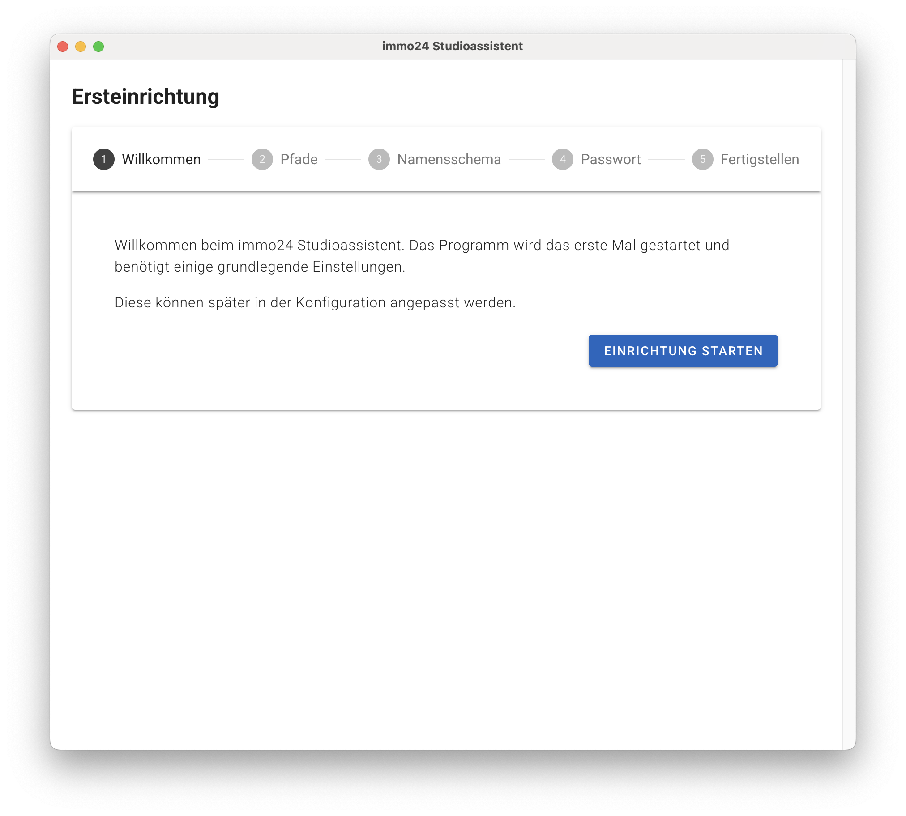
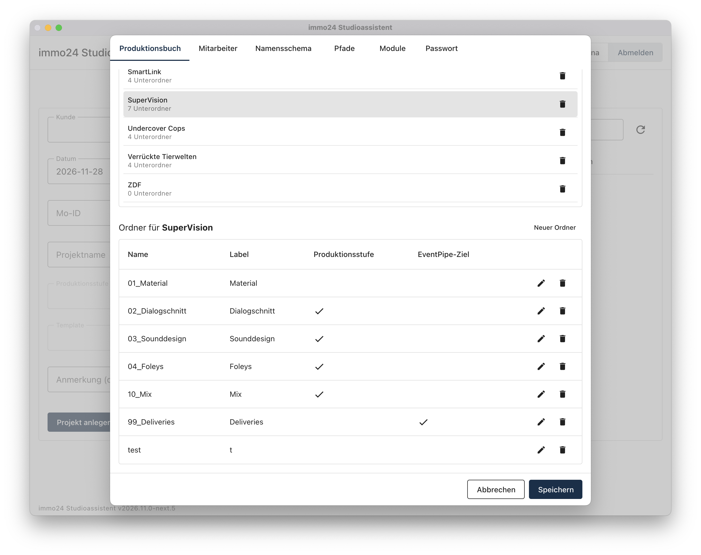
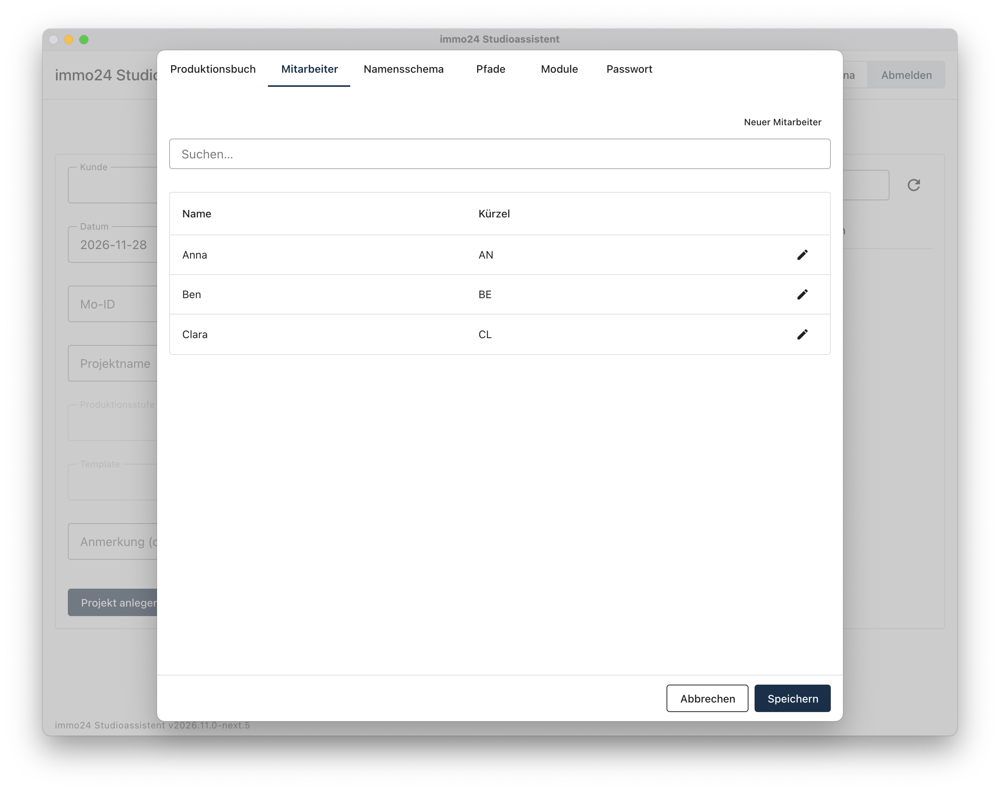
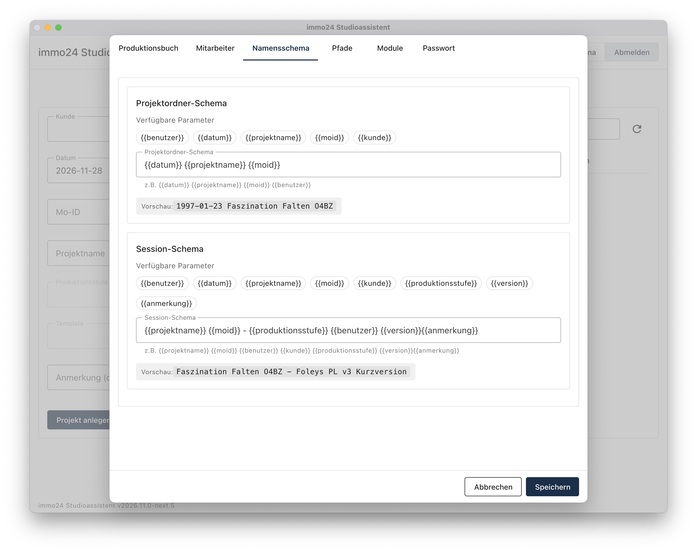
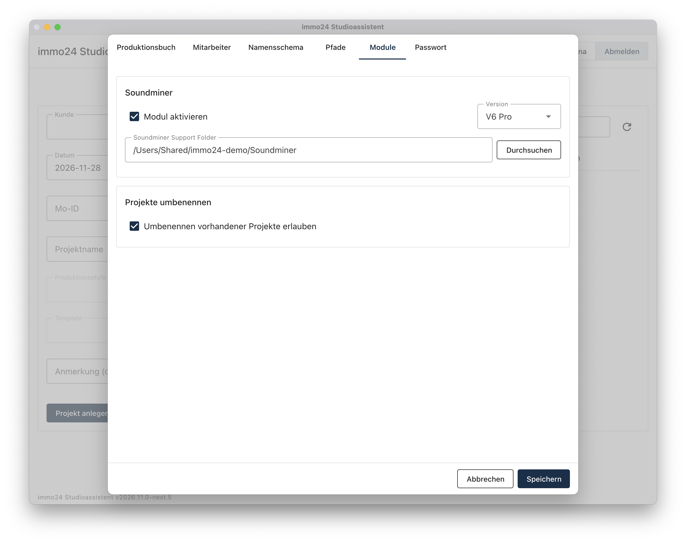
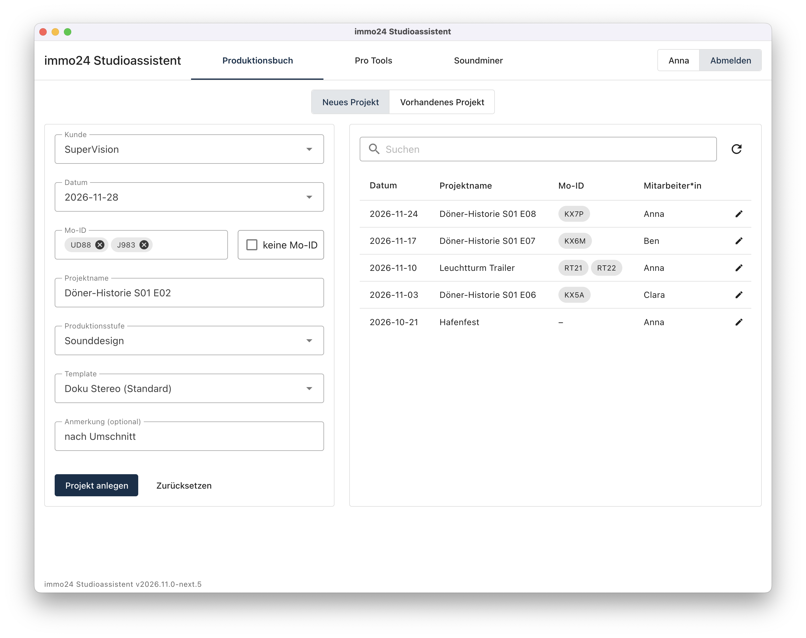
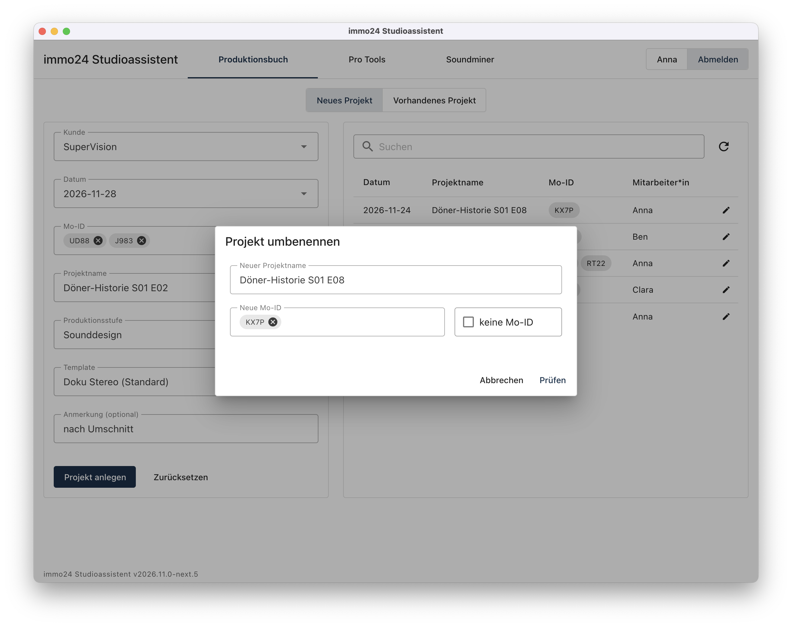
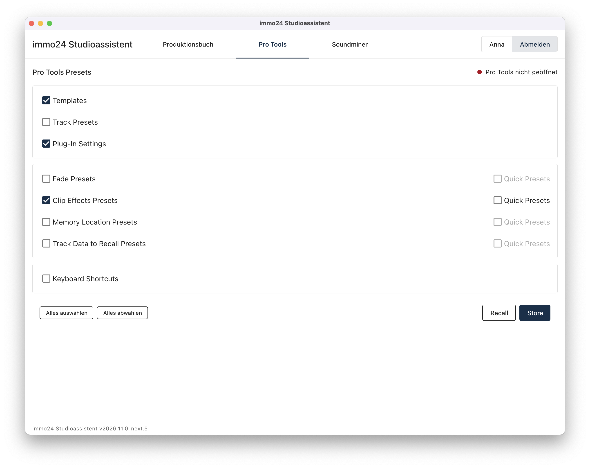
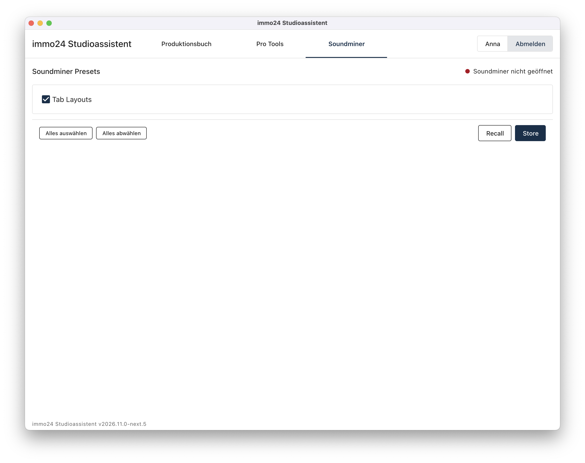

# immo24 Studioassistent

Der immo24 Studioassistent ist eine Desktop-App für vernetzte Avid Pro Tools Systeme. Er legt Projekte und Sessions nach festen Namensregeln an und speichert die persönlichen Presets der Mitarbeiter auf dem gemeinsamen Speicher, damit jeder an jedem Platz mit seinen Einstellungen arbeiten kann.

---

## Features

- Projektanlage nach Namenskonventionen und Vorlagen, mit fester Ordnerstruktur pro Kunde
- Projekte nachträglich umbenennen (optional)
- Gemeinsame Standardvorlagen für alle Mitarbeiter
- Store und Recall der Pro Tools Presets
- Store und Recall der Soundminer Presets (v6)
- Anmeldung pro Mitarbeiter
- macOS (Apple Silicon) und Windows (x64)

---

## Ersteinrichtung

Beim ersten Start öffnet sich der **Einrichtungsassistent**. Er führt durch die grundlegenden Einstellungen, die später jederzeit im Konfigurationsmenü angepasst werden können.



---

## Konfiguration

Das Konfigurationsmenü öffnet man über **Menüleiste → immo24 Studioassistent → Konfiguration**  oder mit **CMD+,** (macOS) bzw. **STRG+,** (Windows).

Sie ist durch ein Passwort geschützt. Das Passwort ist nur eine Sperre gegen versehentliche Änderungen, kein echter Zugriffsschutz. Änderungen sollten mit Bedacht vorgenommen werden.

### Produktionsbuch
- Hier werden die Kunden-Stammdaten angelegt. Ein Kunde entspricht einem Unterverzeichnis im Ordner `Produktionen`. 

- Für jeden Kunden legt man fest, welche Unterordner ein neues Projekt bekommt, z.B.:
```
01_Material
02_Dialogschnitt
03_Sounddesign
04_Foleys
10_Mischung
99_Deliveries
```

- Unterordner-Eigenschaften:
    - **Name**: Der Name des Ordners auf dem Speicher
    - **Label**: Der Name des Ordners in der immo24 Oberfläche und ggf. je nach Schema in Dateinamen
    - **Produktionsstufe**: in diesem Ordner können Pro Tools Sessions angelegt werden
    - **EventPipe-Ziel**: hierhin exportiert später die immo24 EventPipe

- Jeder Kunde kann seine eigene Struktur haben.



### Mitarbeiter
- Mitarbeiter = Unterverzeichnis im Ordner `Mitarbeiter`.  
- Jeder Mitarbeiter hat ein **Kürzel**, das bei Projekterstellung in Dateinamen verwendet werden kann.  
- Im Unterordner `immo24` werden alle projektrelevanten Daten gespeichert:  
    - Kürzel (`immo24-user.json`)  
    - Pro Tools Templates  
    - Plug-In Settings

Der Rest des Ordners steht frei zur Verfügung, etwa für Backups oder Testprojekte. Fehlen bei der Anmeldung Ordner unter `immo24`, legt die App sie an.



### Namensschema
- Projekte & Sessions folgen einem festen **Namensschema**.
    - Als Projektordner wird der Ordner bezeichnet, in dem alle Unterordner, Sessions, etc. liegen.
    - Die Session ist die *.ptx-Datei mit der Pro Tools Session.
- Variablen + Freitext kombinierbar, Vorschau zeigt Beispielausgabe. Das Session-Schema muss die Version beinhalten.
- Mit dem Platzhalter `{{anmerkung}}` gibt es bei der Projektanlage ein zusätzliches Feld für eine Anmerkung wie „Kurzversion“. Die Version zählt trotzdem durch: nach „v5 Kurzversion“ kommt „v6“.

- **Achtung:** Das Namensschema sollte nicht im laufenden Betrieb geändert werden, da nach einer Änderung vorhandene Projekte nicht mehr über immo24 Studioassistent bearbeitet werden können.



### Pfade
- **Mitarbeiter**: siehe *Mitarbeiter*
- **Produktionen**: siehe *Produktionsbuch*
- **Stammdaten**: Namensschema und Kundendaten (z. B. auf Netzlaufwerk für gemeinsame Nutzung)
- **Pro Tools User**: typischerweise `/Users/<username>/Documents/Pro Tools` (macOS) oder `C:\Users\<username>\Documents\Pro Tools` (Windows)
- **Standardvorlagen** (optional): Ordner mit Session-Vorlagen für alle, z. B. auf dem gemeinsamen Speicher. Leer lassen, wenn nur die eigenen Vorlagen gebraucht werden.

### Module
Zusatzfunktionen, die erst eingeschaltet werden müssen.

**Soundminer**
- Nach dem Einschalten und Speichern erscheint der Bereich Soundminer.
- **Version**: zurzeit nur Soundminer V6 Pro
- **Soundminer Support Folder**: Pfad zum Support-Ordner von Soundminer

**Projekte umbenennen**
Erlaubt das Umbenennen vorhandener Projekte (siehe unten). Standardmäßig aus.



### Passwort
- Änderung des Passworts für das Konfigurationsmenü.

---

## Verwendung

### Login
Beim Start erscheint eine **Benutzer-Auswahl** (Dropdown aller Mitarbeiter).  
Nach Auswahl → „Anmelden“.

### Projektanlage

Über das Eingabeformular können Projekte und Sessions angelegt werden.  
Unterschieden wird zwischen **Neuem Projekt** und **Vorhandenem Projekt**.

#### Neues Projekt
- **Kunde**: aus dem Produktionsbuch
- **Datum**: vorbelegt mit heute, immer im Format JJJJ-MM-TT
- **Mo-ID**: Medienorganisations-ID, eindeutige vierstellige ID. Gehören mehrere zu einem Projekt, einfach nacheinander eintippen, aus `ab12 cd34` wird `AB12+CD34`. Ist eine Mo-ID beim selben Kunden schon vergeben, springt die App zum vorhandenen Projekt. Projekte ohne Mo-ID bekommen bei **keine Mo-ID** einen Haken. Ältere Projekte mit `NOID` oder `xxxx` zählen ebenfalls als Projekte ohne Mo-ID.
- **Projektname**: Arbeitstitel oder Klarname
- **Produktionsstufe**: der Ordner, in dem die Session angelegt wird
- **Template**: die eigenen Vorlagen aus `Mitarbeiter/<Name>/immo24/templates/*.ptxt`, darunter die Standardvorlagen mit dem Zusatz „(Standard)“

**Projekt anlegen** erstellt den Projektordner mit allen Unterordnern, die Session und die Datei `immo24-proj.json`. Danach kann das Projekt direkt in Pro Tools geöffnet werden. **Zurücksetzen** leert das Formular.



#### Vorhandenes Projekt
- Rechts: Liste vorhandener Projekte (nur mit `immo24-proj.json`).  
- Filter & Refresh möglich.  
- Neue Sessions können in bestehenden Projekten erzeugt werden.  
- Gleiche Produktionsstufe → automatische Versionsnummer.  

#### Projekt umbenennen
Ist das Modul eingeschaltet, erscheint in der Projektliste ein Stift. Damit lassen sich Projektname und Mo-ID ändern.

- Eine Vorschau zeigt vorher den neuen Ordnernamen.
- Pro Tools muss auf diesem Rechner geschlossen sein. Liegen Sperrdateien einer offenen Session im Projekt, zeigt die App sie an und benennt nicht um.
- Vorhandene Sessions behalten ihren Namen. Neue Sessions bekommen den neuen Namen, die Version zählt weiter.
- Videodateien müssen danach eventuell neu in die Session importiert werden.
- Die früheren Namen stehen in `immo24-proj.json` im Feld `umbenannt`.




### Modul: Pro Tools
Über das **Pro Tools Modul** können individuelle Presets und Templates zwischen einem zentralen Speicherort und dem lokalen Pro Tools-Verzeichnis synchronisiert werden.  

Aktionen:
- **Store** → lokale Files → zentraler Mitarbeiter-Ordner  
- **Recall** → zentrale Files → lokales Pro Tools-Verzeichnis  

> Hinweis: Einige Presets nur synchronisieren, wenn Pro Tools geschlossen ist.  

Gespeicherte Daten liegen in:  
`Mitarbeiter/<Name>/immo24`



### Modul: Soundminer

Über das **Soundminer Modul** können individuelle Presets und Templates zwischen einem zentralen Speicherort und dem lokalen Soundminer-Verzeichnis synchronisiert werden.

Aktuell können nur die Tab-Layouts synchronisiert werden.

Aktionen:
- **Store** → lokale Files → zentraler Mitarbeiter-Ordner  
- **Recall** → zentrale Files → lokales Soundminer-Verzeichnis  

> Hinweis: Das Soundminer-Modul muss in der Konfiguration aktiviert werden. 
> Einige Presets können nur synchronisiert werden, wenn Soundminer geschlossen ist.  

Gespeicherte Daten liegen in:  
`Mitarbeiter/<Name>/immo24/soundminer`



### Abmelden
- Über „Abmelden“ den Benutzer wechseln.  
- Alternativ: Anwendung schließen.

---

## Debug-Modus
Die App schreibt ein Log nach `logs/app.log` im Einstellungsordner. Wird sie mit `--immo24-debug` gestartet, steht dort zusätzlich jeder Vorgang mit Dauer und Ergebnis, und im Menü erscheint „Entwickler“ mit der Konsole.

Mac:

```bash
open -a "immo24 Studioassistent" --args --immo24-debug
```

Windows: das Programm mit `--immo24-debug` starten und das Log in PowerShell mitlesen:

```powershell
Get-Content "$env:APPDATA\immo24-studioassistent\logs\app.log" -Wait -Tail 50
```

## Lizenz

Der immo24 Studioassistent steht unter der [GNU Affero General Public License v3.0](./LICENSE). Wer ihn verändert und weitergibt oder als Dienst betreibt, muss den Quellcode samt Änderungen ebenfalls unter der AGPL veröffentlichen.

Die Lizenzen der verwendeten Fremdsoftware stehen in [NOTICE](./NOTICE) und im Ordner [LICENSES](./LICENSES).
